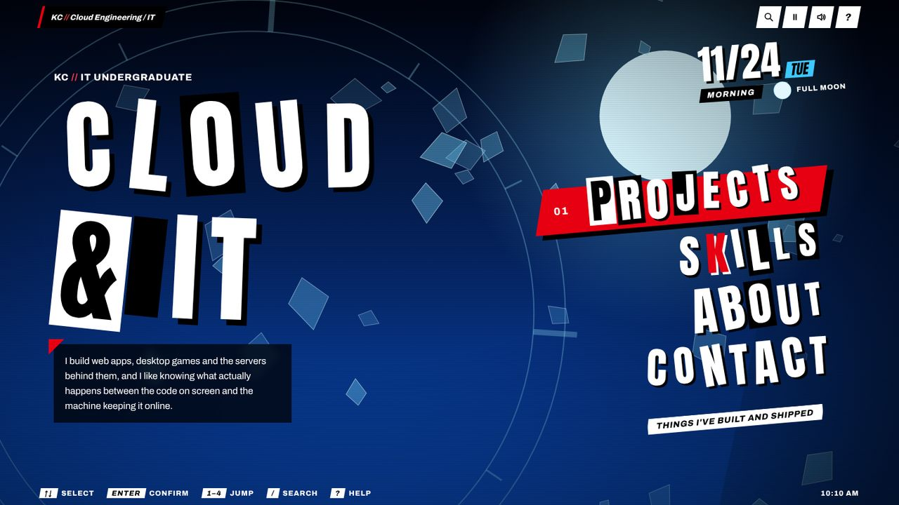

<h1 align="center">Persona Portfolio</h1>

<p align="center"><b>A portfolio you can switch between Persona 5, Persona 5 Royal and Persona 3 Reload.</b></p>

<p align="center">
  <a href="https://kcarnage1.github.io/My-Persona-Portfolio/"></a>
  
  
</p>

<p align="center">
  
</p>


A Persona 5, Persona 5 Royal and Persona 3 Reload-styled (switchable) portfolio in plain HTML, CSS and JavaScript. No framework and no build step: open `index.html`, or host the folder on GitHub Pages as-is.

## What is in it

- Home, Projects, Skills, About and Contact screens with wipe transitions between them and a quick-jump search.
- Three looks (Persona 5, Persona 5 Royal, Persona 3 Reload), each with its own colours, lettering and animated background for every screen.
- A music playlist with a player, volume, seeking and an equalizer. Each look plays its own song (Beneath the Mask for Persona 5, Last Surprise for Royal, Color Your Night for Reload), plus sound effects and a sprite cursor with a trail.
- The animated wallpaper is drawn in a Web Worker on an OffscreenCanvas, so it stays off the page's main thread (it falls back to the main thread when workers are unavailable, for example when index.html is opened straight from disk).
- Respects reduced-motion settings, works by keyboard and on a phone, and the animation runs by elapsed time so it feels the same on 60 Hz and 120 Hz+ screens.

## Run it

```bash
python3 -m http.server 8000    # then open http://localhost:8000
```

Any static file server works. Music seeking needs one that supports range requests, which GitHub Pages does.

## Editing content

Everything you'd normally change lives in `js/model.js`:

- **projects**: the project cards. Copy a block to add one. `cat` picks the filter (`web`, `game`, `mod`, `tool`; `small` makes a "Smaller builds" group), `links` are the buttons, `highlights` fill the Details window, `color` tints the card (add `ink: "#fff"` if the colour is dark), and `img` (optional) swaps the drawn cover for a screenshot such as `assets/projects/my-app.jpg`. `shots` lists screenshots for the gallery.
- **skills**: three groups of six skills each (one hexagon per group). `v` is your own 0-100 rating, `short` is the chart label, `uses` lists project ids so each skill links to where you used it.
- **about**: chapters of paragraphs; `**bold**` becomes a highlight.
- Public repos that aren't featured appear automatically under "More on GitHub".

## Controls

`↑ ↓` + `Enter` on the menu · `1-4` jump to a section · `Q / E` (or `← →`) switch sections · `/` or `Ctrl + K` quick jump · `Esc` back · `P` play or pause the music · `[` `]` previous or next song · `M` sound effects · `T` switch look (Persona 5 → Persona 5 Royal → Persona 3 Reload, remembered) · `B` pause the background · `?` help

## Credits

Animation uses [GSAP](https://gsap.com) and ScrollTrigger, bundled in `js/vendor/` under GreenSock's standard no-charge license.
